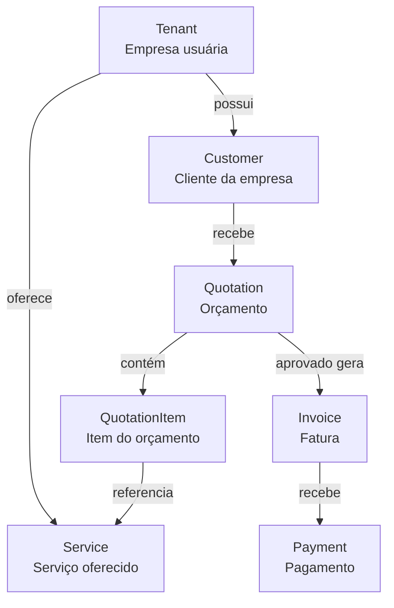
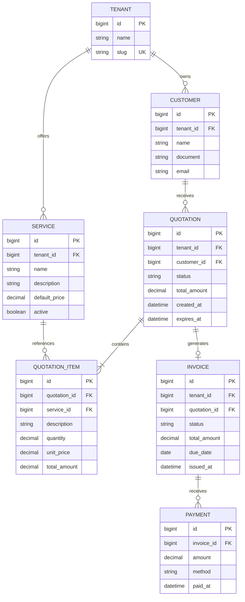

# Auxy API

Projeto criado para estudo e prática de desenvolvimento backend utilizando Java e Spring Boot.

O objetivo é exercitar conceitos modernos do ecossistema Java, arquitetura backend, APIs REST, persistência de dados e práticas comuns encontradas em aplicações corporativas.

## Índice
- [Tecnologias](#tecnologias)
- [Domínio do projeto](#domínio-do-projeto)
- [Estrutura de módulos](#estrutura-de-módulos)
- [Etapas do projeto](#etapas-do-projeto)
  - Etapa 1 — Estrutura inicial
  - Etapa 2 — API REST de Tenant
  - Etapa 3 — Validação
  - Etapa 4 — Persistência
  - Etapa 5 — Relacionamentos
  - Etapa 6 — Tratamento de erros
  - Etapa 7 — Testes
  - Etapa 8 — Infraestrutura
  - Etapa 9 — Arquitetura e produção

## Tecnologias

- Java 21
- Spring Boot
- Maven
- PostgreSQL
- Spring Data JPA / Hibernate
- Validation
- Git / GitHub

## Domínio do projeto

A aplicação está sendo modelada como uma plataforma multi-tenant e utiliza uma organização modular baseada nos principais conceitos do domínio:

- `Tenant`: empresa que utiliza a plataforma;
- `Customer`: cliente pertencente a um tenant;
- `Service`: serviço oferecido por um tenant;
- `Quotation`: orçamento criado para um cliente;
- `QuotationItem`: serviço incluído em um orçamento, com preço e quantidade;
- `Invoice`: cobrança gerada a partir de um orçamento aprovado;
- `Payment`: pagamento total ou parcial de uma fatura.

Todos os dados de negócio são associados a um Tenant, direta ou indiretamente, permitindo o isolamento lógico entre organizações.

O fluxo de negócio é representado abaixo de forma conceitual. Em seguida, o diagrama entidade-relacionamento detalha as estruturas persistidas.



## Estrutura de módulos

A aplicação é organizada por módulos de negócio dentro do package `domain`, seguindo uma abordagem parcial inspirada em Domain-Driven Design (DDD).

```text
br.com.fastdevelopment.auxy/
└── domain/
    ├── tenant/
    │   ├── controller/
    │   ├── service/
    │   ├── repository/
    │   ├── entity/
    │   └── dto/
    └── customer/
        ├── controller/
        ├── service/
        ├── repository/
        ├── entity/
        └── dto/
```

Neste momento, os módulos `tenant` e `customer` fazem parte do escopo de
implementação. Os módulos de catálogo, orçamentos e faturamento permanecem como
possíveis evoluções futuras.

<details>
<summary>Ver diagrama entidade-relacionamento completo</summary>


</details>

## Etapas do Projeto

<details>
<summary>✅ Etapa 1 - Estrutura Inicial do Projeto</summary>

### Objetivos

- Criar projeto Spring Boot
- Configurar Maven
- Configurar Java 21
- Configurar Git
- Configurar GitHub
- Implementar endpoint de Health Check
- Configurar application.yml
- Configurar application-local.example.yml
- Configurar profiles de ambiente
- Permitir inicialização da aplicação sem banco de dados

### Conceitos

- Spring Boot Bootstrap
- Maven
- Profiles
- YAML
- Versionamento com Git
- Publicação no GitHub
- Auto Configuration
- DataSource Auto Configuration

</details>

---

<details>
<summary>✅ Etapa 2 - API REST de Tenant</summary>

### Objetivos

- Estruturar as camadas da aplicação
- Implementar CRUD de Tenant
- Expor endpoints REST
- Criar contratos de Request e Response

### Endpoints

- GET /tenants
- GET /tenants/{id}
- POST /tenants
- PATCH /tenants/{id}
- DELETE /tenants/{id}

### Estrutura

- Controller
- Service
- DTO Response
- DTO Request

### Conceitos

- Injeção de Dependência
- IoC Container
- Serialização JSON
- PathVariable
- RequestBody
- ResponseEntity
- Status HTTP

</details>

---

<details>
<summary>✅ Etapa 3 - Validação de Dados</summary>

### Objetivos

- @NotNull
- @NotBlank
- @Size
- Validação automática do Spring

### Conceitos

- Bean Validation
- Contratos de API

</details>

---

<details>
<summary>✅ Etapa 4 - Persistência com PostgreSQL e JPA</summary>

### Objetivos

- Configurar PostgreSQL
- Configurar DataSource
- Configurar profiles de ambiente
- Configurar credenciais por variável de ambiente
- Integrar aplicação com banco de dados
- Criar entidade `Tenant`
- Criar `TenantRepository`
- Implementar persistência de `Tenant`
- Substituir armazenamento em memória por persistência real
- Manter entidades separadas dos DTOs
- Mapear entidades e DTOs com MapStruct
- Normalizar o slug antes da persistência
- Garantir unicidade do slug no banco de dados

### Conceitos

- JDBC
- Connection Pool
- Configuração por ambiente
- ORM
- JPA
- Hibernate
- Entity
- Repository
- JpaRepository
- Ciclo de vida das entidades
- Entity versus DTO
- MapStruct
- Lombok
- Query derivation
- Restrições de unicidade
- Geração automática de schema

</details>

---

<details>
<summary>✅ Etapa 5 - Relacionamentos e contexto de Tenant</summary>

### Objetivos

- Reorganizar o módulo `Tenant` dentro de `domain.tenant`
- Criar o módulo `Customer` dentro de `domain.customer`
- Criar a entidade `Customer`
- Criar o relacionamento `Tenant` → `Customer`
- Implementar CRUD de `Customer`
- Buscar customers pelo tenant atual sem expor `tenantId` na URL
- Usar o header `X-Tenant-Id` para identificar o tenant atual durante o desenvolvimento
- Criar um contexto de tenant por requisição
- Limpar o contexto ao final de cada requisição
- Garantir que as consultas e operações de `Customer` respeitem o tenant atual
- Garantir unicidade de e-mail por tenant

### Conceitos

- `@OneToMany`
- `@ManyToOne`
- Contexto de Tenant
- `HandlerInterceptor`
- Header HTTP para identificação do tenant
- `ThreadLocal` e escopo da requisição
- Fetch Types
- Integridade referencial
- Isolamento multi-tenant

### Conceitos para aprofundamento futuro

- Cascades
- Validação centralizada da existência do tenant
- Autenticação e autorização do tenant
- Substituição do header por um tenant obtido a partir do usuário autenticado

Os módulos `Service`, `Quotation`, `QuotationItem`, `Invoice` e `Payment` não
fazem parte desta etapa. Eles poderão ser implementados posteriormente caso
sejam úteis para demonstrar novas tecnologias ou conceitos.

</details>

---

<details>
<summary>⬜ Etapa 6 - Tratamento de Erros</summary>

### Objetivos

- Criar exceptions customizadas para regras de negócio
- Criar um Global Exception Handler
- Padronizar respostas de erro da API
- Tratar erros de validação dos requests
- Tratar recursos não encontrados
- Tratar tenant ausente ou inválido
- Tratar conflitos de unicidade
- Tratar headers malformados
- Tratar erros inesperados sem expor detalhes internos
- Definir códigos HTTP coerentes para cada tipo de erro
- Registrar erros relevantes em logs estruturados

### Conceitos

- `@RestControllerAdvice`
- `@ExceptionHandler`
- Exceptions de domínio e aplicação
- `ProblemDetail`
- Status HTTP
- Contrato de erro
- Validação com Bean Validation
- Logs estruturados

</details>

---

<details>
<summary>⬜ Etapa 7 - Testes</summary>

### Objetivos

- Testes unitários
- Testes de integração
- Testes de Controller
- Testes de Service

### Conceitos

- JUnit
- Mockito
- Spring Boot Test

</details>

---

<details>
<summary>⬜ Etapa 8 - Infraestrutura</summary>

### Objetivos

- Docker
- Docker Compose
- PostgreSQL em container
- Ambientes locais padronizados

</details>

---

<details>
<summary>⬜ Etapa 9 - Arquitetura e Produção</summary>

### Objetivos

- Observabilidade
- Métricas
- Health Checks

</details>
