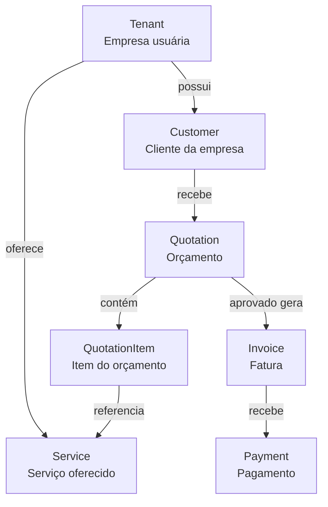
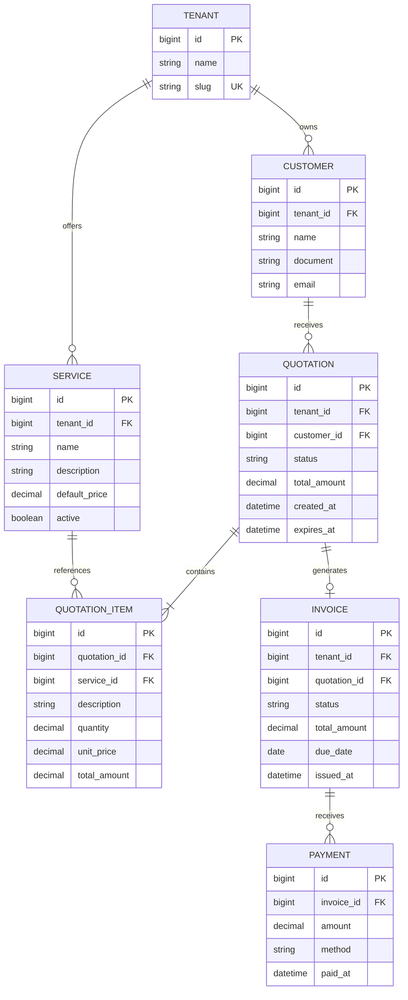

# Auxy API

Projeto criado para estudo e prática de desenvolvimento backend utilizando Java e Spring Boot.

O objetivo é exercitar conceitos modernos do ecossistema Java, arquitetura backend, APIs REST, persistência de dados e práticas comuns encontradas em aplicações corporativas.

## Tecnologias

- Java 21
- Spring Boot
- Maven
- PostgreSQL
- Spring Data JPA / Hibernate
- Validation
- Git / GitHub

## Domínio do projeto

A aplicação está sendo modelada como uma plataforma multi-tenant e utiliza uma organização modular baseada nos principais conceitos do domínio:

- `Tenant`: empresa que utiliza a plataforma;
- `Customer`: cliente pertencente a um tenant;
- `Service`: serviço oferecido por um tenant;
- `Quotation`: orçamento criado para um cliente;
- `QuotationItem`: serviço incluído em um orçamento, com preço e quantidade;
- `Invoice`: cobrança gerada a partir de um orçamento aprovado;
- `Payment`: pagamento total ou parcial de uma fatura.

Todos os dados de negócio são associados a um Tenant, direta ou indiretamente, permitindo o isolamento lógico entre organizações.

O fluxo de negócio é representado abaixo de forma conceitual. Em seguida, o diagrama entidade-relacionamento detalha as estruturas persistidas.



## Estrutura de módulos

A aplicação é organizada por módulos de negócio, seguindo uma abordagem parcial inspirada em Domain-Driven Design (DDD).

```text
br.com.fastdevelopment.auxy/
├── tenant/
│   ├── controller/
│   ├── service/
│   ├── repository/
│   ├── entity/
│   └── dto/
├── customer/
│   ├── controller/
│   ├── service/
│   ├── repository/
│   ├── entity/
│   └── dto/
├── catalog/
│   ├── controller/
│   ├── service/
│   ├── repository/
│   ├── entity/
│   └── dto/
├── quotation/
│   ├── controller/
│   ├── service/
│   ├── repository/
│   ├── entity/
│   └── dto/
└── billing/
    ├── controller/
    ├── service/
    ├── repository/
    ├── entity/
    └── dto/
```

Atualmente, o módulo `tenant` está implementado. Os demais módulos fazem parte
do planejamento de evolução da aplicação.


   
---

<details>
<summary>✅ Etapa 1 - Estrutura Inicial do Projeto</summary>

### Objetivos

- Criar projeto Spring Boot
- Configurar Maven
- Configurar Java 21
- Configurar Git
- Configurar GitHub
- Implementar endpoint de Health Check
- Configurar application.yml
- Configurar application-local.example.yml
- Configurar profiles de ambiente
- Permitir inicialização da aplicação sem banco de dados

### Conceitos

- Spring Boot Bootstrap
- Maven
- Profiles
- YAML
- Versionamento com Git
- Publicação no GitHub
- Auto Configuration
- DataSource Auto Configuration

</details>

---

<details>
<summary>✅ Etapa 2 - API REST de Tenant</summary>

### Objetivos

- Estruturar as camadas da aplicação
- Implementar CRUD de Tenant
- Expor endpoints REST
- Criar contratos de Request e Response

### Endpoints

- GET /tenants
- GET /tenants/{id}
- POST /tenants
- PATCH /tenants/{id}
- DELETE /tenants/{id}

### Estrutura

- Controller
- Service
- DTO Response
- DTO Request

### Conceitos

- Injeção de Dependência
- IoC Container
- Serialização JSON
- PathVariable
- RequestBody
- ResponseEntity
- Status HTTP

</details>

---

<details>
<summary>✅ Etapa 3 - Validação de Dados</summary>

### Objetivos

- @NotNull
- @NotBlank
- @Size
- Validação automática do Spring

### Conceitos

- Bean Validation
- Contratos de API

</details>

---

<details>
<summary>✅ Etapa 4 - Persistência com PostgreSQL e JPA</summary>

### Objetivos

- Configurar PostgreSQL
- Configurar DataSource
- Configurar profiles de ambiente
- Configurar credenciais por variável de ambiente
- Integrar aplicação com banco de dados
- Criar entidade `Tenant`
- Criar `TenantRepository`
- Implementar persistência de `Tenant`
- Substituir armazenamento em memória por persistência real
- Manter entidades separadas dos DTOs
- Mapear entidades e DTOs com MapStruct
- Normalizar o slug antes da persistência
- Garantir unicidade do slug no banco de dados

### Conceitos

- JDBC
- Connection Pool
- Configuração por ambiente
- ORM
- JPA
- Hibernate
- Entity
- Repository
- JpaRepository
- Ciclo de vida das entidades
- Entity versus DTO
- MapStruct
- Lombok
- Query derivation
- Restrições de unicidade
- Geração automática de schema

</details>

---

<details>
<summary>⬜ Etapa 5 - Relacionamentos</summary>

### Objetivos

- Criar relacionamento entre Tenant e Customer
- Aplicar validações de dados de Customer, incluindo `@Email`
- Criar catálogo de Services por Tenant
- Criar Quotation pertencente a um Customer
- Criar QuotationItem para representar os serviços do orçamento
- Preservar preço e descrição do serviço no momento da criação do orçamento
- Gerar Invoice a partir de uma Quotation aprovada
- Registrar Payment relacionado a uma Invoice
- Garantir isolamento dos dados por Tenant

### Conceitos

- `@OneToMany`
- `@ManyToOne`
- Entidades associativas
- Relacionamento entre `Quotation` e `QuotationItem`
- Composição de agregados
- Cascades
- Fetch Types
- Integridade referencial
- Isolamento multi-tenant

</details>

---

<details>
<summary>⬜ Etapa 6 - Tratamento de Erros</summary>

### Objetivos

- Exceptions customizadas
- Global Exception Handler
- Padronização de respostas
- Mensagens de erro amigáveis

### Conceitos

- @RestControllerAdvice
- @ExceptionHandler

</details>

---

<details>
<summary>⬜ Etapa 7 - Testes</summary>

### Objetivos

- Testes unitários
- Testes de integração
- Testes de Controller
- Testes de Service

### Conceitos

- JUnit
- Mockito
- Spring Boot Test

</details>

---

<details>
<summary>⬜ Etapa 8 - Infraestrutura</summary>

### Objetivos

- Docker
- Docker Compose
- PostgreSQL em container
- Ambientes locais padronizados

</details>

---

<details>
<summary>⬜ Etapa 9 - Arquitetura e Produção</summary>

### Objetivos

- Multi-tenancy
- Observabilidade
- Logs estruturados
- Métricas
- Health Checks

</details>
